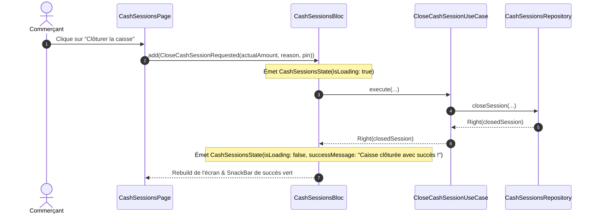

# 01 — Architecture Clean Code & Gestion d'État BLoC

Ce document détaille l'organisation architecturale du code source Flutter de **ARIKE**, le découpage en couches (Clean Architecture) et la gestion d'état réactive avec le pattern **BLoC**.

---

## 1. Principes de la Clean Architecture

Pour garantir la testabilité, la maintenabilité et l'indépendance vis-à-vis des frameworks graphiques ou des pilotes de base de données, chaque fonctionnalité (`feature`) du frontend est scindée en 3 couches concentriques :

```mermaid
flowchart TD
    subgraph Presentation ["1. Couche Présentation (UI & State)"]
        Pages[Pages & Écrans]
        Widgets[Widgets Réutilisables]
        Bloc[BLoC: Events & States]
    end

    subgraph Domain ["2. Couche Domaine (Cœur Métier Pur - Pas de dépendance Flutter)"]
        Entities[Entités Métier]
        UseCases[Cas d'Utilisation]
        RepoInterfaces[Interfaces des Dépôts]
    end

    subgraph Data ["3. Couche Données (Implémentations & Stockage)"]
        RepoImpl[Implémentations Dépôts]
        LocalDS[Local Data Source: Drift / SQLite]
        RemoteDS[Remote Data Source: Dio / API REST]
        Models[Modèles & Sérialiseurs]
    end

    Pages --> Bloc
    Bloc --> UseCases
    UseCases --> RepoInterfaces
    RepoImpl ..|> RepoInterfaces
    RepoImpl --> LocalDS
    RepoImpl --> RemoteDS
```

### 1.1 Couche Domaine (`domain/`) — Cœur Métier Pur
- **Entités (`entities/`)** : Objets métier fondamentaux (ex : `CashSession`, `Sale`, `Product`, `Debt`). Immuables et héritant de `Equatable`.
- **Cas d'Utilisation (`usecases/`)** : Actions métier atomiques (ex : `OpenCashSessionUseCase`, `CloseCashSessionUseCase`, `VerifyShopOwnerPinUseCase`, `CreateSaleUseCase`).
- **Interfaces de Dépôts (`repositories/`)** : Contrats abstraits définissant les opérations requises sans préjuger de la manière dont les données sont stockées.

### 1.2 Couche Données (`data/`)
- **Modèles (`models/`)** : Extensions des entités du domaine intégrant la conversion JSON et le mapping vers les tables Drift SQLite (`fromMap`, `toMap`, `toJson`).
- **Sources de Données (`datasources/`)** :
  - `*_local_datasource.dart` : Accès direct à la base de données Drift SQLite locale.
  - `*_remote_datasource.dart` : Client HTTP (Dio) communiquant avec le backend NestJS.
- **Implémentations de Dépôts (`repositories/`)** : Implémentent les interfaces du domaine en appliquant la stratégie **Offline-First** (écriture locale immédiate + enregistrement dans la file de synchronisation distante).

### 1.3 Couche Présentation (`presentation/`)
- **BLoC (`bloc/`)** : Reçoit les événements de l'utilisateur (`Event`), exécute les cas d'utilisation, et émet de nouveaux états immuables (`State`).
- **Pages & Widgets (`pages/`, `widgets/`)** : Composants graphiques Flutter réactifs écoutant le BLoC via `BlocBuilder`, `BlocListener` ou `BlocConsumer`.

---

## 2. Le Pattern BLoC (Business Logic Component)

L'architecture sépare rigoureusement la logique métier de l'interface graphique :



### 2.1 Gestion Fonctionnelle des Erreurs (`Either<Failure, T>`)
Pour éliminer les exceptions non gérées et les plantages inopinés, toutes les opérations de dépôt retournent un type fonctionnel :
- `Left(Failure)` en cas d'erreur (ex : `CacheFailure`, `NotFoundFailure`, `PinVerificationFailure`, `NetworkFailure`).
- `Right(T)` en cas de succès avec la donnée métier attendue.

---

## 3. Injection de Dépendances (`injection_container.dart`)

L'application utilise le service locator **GetIt** (`sl = GetIt.instance`) pour instancier et injecter les composants de manière découplée :

```dart
// Exemple d'enregistrement dans injection_container.dart
void initCashSessions() {
  // BLoC (Factory : recréé à chaque écran)
  sl.registerFactory(() => CashSessionsBloc(
    getCashSessionsUseCase: sl(),
    openCashSessionUseCase: sl(),
    closeCashSessionUseCase: sl(),
    verifyShopOwnerPinUseCase: sl(),
  ));

  // UseCases (LazySingleton : instancié au premier besoin)
  sl.registerLazySingleton(() => CloseCashSessionUseCase(sl()));

  // Repository
  sl.registerLazySingleton<CashSessionsRepository>(
    () => CashSessionsRepositoryImpl(localDataSource: sl(), remoteDataSource: sl()),
  );

  // DataSources
  sl.registerLazySingleton<CashSessionsLocalDataSource>(
    () => CashSessionsLocalDataSourceImpl(database: sl()),
  );
}
```

