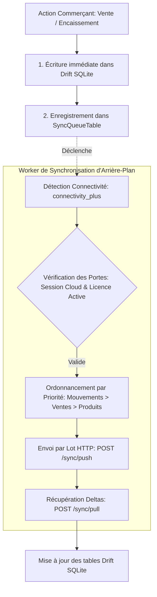

# 03 — Moteur de Synchronisation Client & Résolution des Conflits

Ce document détaille le fonctionnement interne du système de synchronisation côté terminal (Flutter) de **ARIKE**, la gestion de la file d'attente d'envoi (`SyncQueue`) et l'interface utilisateur de résolution des conflits.

---

## 1. Architecture de la Synchronisation Côté Terminal

La synchronisation s'exécute en arrière-plan sans jamais figer l'interface ni ralentir les encaissements :



---

## 2. Les Portes de Sécurité de Synchronisation (`Gates`)

Avant de déclencher une synchronisation réseau, le moteur vérifie une chaîne de préconditions matérielles et contractuelles :

1. **`CloudSessionGate` (`lib/core/sync/gates/cloud_session_gate.dart`)** :
   - Vérifie si l'appareil possède un jeton d'accès cloud valide.
   - Si la session cloud a expiré (ex : après 30 jours sans Internet), la porte suspend la synchronisation et déclenche le dialogue de réparation par PIN gérant (`cloud_session_pin_repair_dialog.dart`) sans déconnecter l'utilisateur localement.
2. **`LicenseGate` (`lib/core/sync/gates/license_gate.dart`)** :
   - Vérifie que la boutique active dispose d'une licence autorisant la synchronisation cloud multi-appareils (formule PRO ou ENTREPRISE).

---

## 3. Moteur de Priorisation (`PriorityEngine`)

Toutes les données n'ont pas la même urgence métier. Le `PriorityEngine` ordonne le vidage de la file d'attente selon 4 niveaux :

1. **Priorité 1 — CRITIQUE (Immédiat)** :
   - Mouvements de caisse, clôtures de caisse, écarts financiers.
   - Enregistrements de ventes et règlements de dettes.
2. **Priorité 2 — ÉLEVÉE (Moins de 30 secondes)** :
   - Créations et mises à jour de fiches clients.
   - Commandes fournisseurs et réceptions de marchandises.
3. **Priorité 3 — NORMALE (En tâche de fond)** :
   - Ajouts de nouveaux produits au catalogue.
   - Modifications des descriptions ou codes-barres.
4. **Priorité 4 — BASSE (Économie de données)** :
   - Téléchargement des photos d'articles en haute résolution.
   - Télémétrie d'usage et journaux d'audit non critiques.

---

## 4. Gestion des Conflits & Interface de Résolution (`SyncResolutionPage`)

Lorsque deux vendeurs en mode hors-ligne modifient simultanément la même ressource (ex : modification concurrente de l'adresse ou du numéro de téléphone d'un client), le backend renvoie un rapport de conflit :

```json
{
  "entity": "customer",
  "id": "cust-uuid-42",
  "conflict_type": "CONCURRENT_UPDATE",
  "server_version": { "name": "Mme ALAPINI", "phone": "+22997111111" },
  "client_version": { "name": "Mme ALAPINI GANHI", "phone": "+22997222222" }
}
```

### Comportement de l'Application :
1. **Résolution Automatique non destructive** :
   Si les champs modifiés sont différents (ex : un appareil a changé l'adresse et l'autre a changé le numéro WhatsApp), le système fusionne automatiquement les deux modifications (Auto-Merge).
2. **Arbitrage Manuel dans le Centre de Synchronisation (`SyncCenterPage`)** :
   En cas de conflit direct sur la même valeur :
   - Un badge orange apparaît sur l'icône de synchronisation dans la barre supérieure.
   - Le commerçant peut ouvrir la page `SyncResolutionPage` qui présente les deux versions côte à côte :
     - Option A : *"Garder la version de cet appareil"*
     - Option B : *"Adopter la version du Cloud"*
     - Option C : *"Fusionner manuellement"*
   - Un seul clic résout le conflit et réaligne la base locale avec le cloud.

