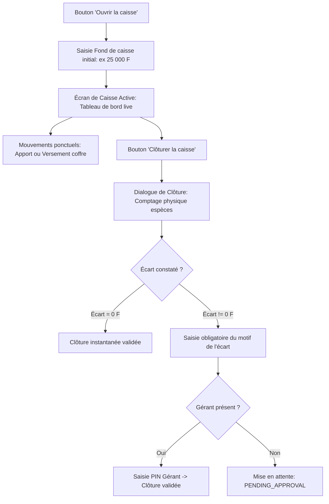

# 04 — Parcours Fonctionnels & Guide des Écrans

Ce document fournit la description fonctionnelle exhaustive de l'ensemble des modules et écrans de l'application **ARIKE (Flutter)**.

---

## 1. Module Sessions de Caisse (`cash_sessions`)

La gestion de caisse est l'épine dorsale de la transparence financière dans ARIKE.

### 1.1 Fonctionnalités Clés de la Caisse
- **Indicateurs en Direct (Live Totaux)** : Affichage en direct du fond initial, des ventes en espèces, des ventes MoMo, des décaissements et du total attendu en caisse.
- **Remplissage Assisté en 1 Clic** : Lors de la clôture, un bouton *"Remplir avec les soldes théoriques attendus"* permet au commerçant de pré-remplir les champs pour gagner du temps tout en visualisant le détail.
- **Gestion des Écarts & Anti-Bloquage** : Si un écart existe et que le PIN du gérant n'est pas encore saisi, l'application informe clairement l'utilisateur avec un message contextuel et propose de soumettre la caisse en approbation (`PENDING_APPROVAL`).
- **Carte Dédiée aux Sessions en Attente (`_PendingApprovalCard`)** : Un bandeau d'alerte bien visible prévient le gérant qu'une session de caisse nécessite sa validation par PIN.

---

## 2. Module Ventes & Caisse POS (`sales`)

L'écran de caisse est optimisé pour une vitesse d'exécution maximale :
- **Recherche & Scan Instantané** : Recherche textuelle instantanée par nom d'article, filtrage par catégorie en carrousel ou scan code-barres avec retour haptique (vibration).
- **Gestion du Panier** : Incrémentation/décrémentation en un geste, application de remise globale ou ligne par ligne, calcul dynamique de la marge brute.
- **Modes de Règlement Mixtes** : Possibilité de panacher les modes de paiement (ex : un client achète pour 50 000 F : il paie 30 000 F en espèces, 10 000 F par MTN MoMo, et les 10 000 F restants sont enregistrés à crédit sur son compte client).
- **Délivrance du Ticket de Caisse** :
  - Impression thermique immédiate sur imprimante Bluetooth 58mm ou 80mm.
  - Envoi instantané du ticket dématérialisé au client par WhatsApp ou SMS.

---

## 3. Module Dettes Clients & Recouvrement (`debts`, `customers`)

- **Fiches Clients** : Historique complet des achats, total des dettes en cours, date de la dernière vente, plafond de crédit autorisé.
- **Échéancier Visuel** : Code couleur immédiat (Vert = Dette active à jour, Rouge = Dette en retard d'échéance `OVERDUE`).
- **Relance WhatsApp en 1 Clic** : Un bouton dédié ouvre directement l'application WhatsApp du téléphone sur le numéro du client avec un message soigné et le récapitulatif précis de la créance.
- **Règlement Partiel ou Total** : Enregistrement des acomptes avec génération de reçu de décharge de paiement.

---

## 4. Module Stocks, Lots & Approvisionnements (`inventory`, `procurement`)

- **Catalogue Produits** : Gestion des références, conditionnements (détail, carton, sac), prix d'achat et prix de vente.
- **Alerte Stock Critique** : Notification visuelle dès qu'un produit atteint son seuil de réapprovisionnement.
- **Suivi des Lots & DLC/DLUO** : Suivi des dates limites de consommation pour les produits alimentaires ou cosmétiques périssables.
- **Transferts Inter-Boutiques** : Expédition de marchandises d'une boutique vers une autre avec bon de transfert et validation de réception par le destinataire.

---

## 5. Sauvegardes Google Drive Chiffrées (`backup`)

Pour éviter toute perte de données en cas de panne, vol ou changement de téléphone :
- **Connexion Google Sécurisée** : L'utilisateur se connecte directement à son propre compte Google via Google OAuth (`google_sign_in`).
- **Chiffrement AES-256 Avant Envoi** : L'application extrait une copie de la base SQLite locale, la compresse et la chiffre avec une clé secrète connue uniquement du commerçant (`shop_backup_crypto.dart`).
- **Stockage Transparent sur Google Drive** : Le fichier chiffré `.arikebackup` est téléversé directement dans le dossier privé Google Drive du commerçant. Aucune donnée non chiffrée ne transite par des serveurs tiers.
- **Restauration en 1 Clic** : Sur un nouveau terminal, le commerçant télécharge son fichier de sauvegarde Google Drive, saisit son mot de passe de déchiffrement, et retrouve l'intégralité de sa comptabilité en quelques secondes.

---

## 6. Saisie Vocale Intelligente & Calculatrices (`voice_input`, `calculators`)

- **Saisie Vocale (Speech-to-Text)** : Le commerçant appuie sur le micro et dit : *"Trois sacs de riz et un bidon d'huile"*. L'algorithme d'analyse sémantique locale reconnaît les produits du catalogue, les quantités et les ajoute directement au panier.
- **Calculateur de Marge Commerciale** : Outil intégré permettant de calculer instantanément le taux de marge, le prix de vente idéal selon un coefficient multiplicateur ou le seuil de rentabilité après déduction des charges fixes.
- **Bureau de Change (FX Exchange)** : Convertisseur temps réel de devises locales et internationales (FCFA, EUR, USD, Naira NGN) avec gestion de session de caisse dédiée aux opérations de change.

