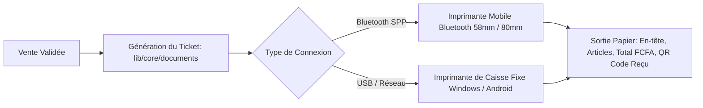

# 05 — Intégrations Matérielles & Périphériques POS

Ce document décrit la prise en charge des équipements et périphériques matériels de point de vente dans **ARIKE** : imprimantes thermiques de reçus, douchettes et scanners de codes-barres, et capteurs biométriques.

---

## 1. Imprimantes Thermiques de Reçus (ESC/POS)

ARIKE prend en charge l'impression directe sans fil et filaire sur les imprimantes thermiques de caisse via le protocole standardisé **ESC/POS** :

### 1.1 Formats de Papier & Compatibilité
- **Largeur 58mm (2 pouces)** : Format standard des imprimantes portables de ceinture utilisées sur les marchés (ex : Goojprt, Milestone, Zjiang, Xprinter).
- **Largeur 80mm (3 pouces)** : Format des imprimantes de comptoir de supermarché avec massicot automatique (Auto-Cutter).

### 1.2 Structure du Ticket Imprimé
Le ticket est généré via la bibliothèque `printing` et le moteur de mise en page PDF/Raster :
1. **En-tête** : Nom de la boutique, adresse physique, téléphone et numéro IFU/RCCM.
2. **Métadonnées** : Numéro séquentiel du ticket (`#VT-2026-089`), date, heure, nom du caissier.
3. **Tableau des Articles** : Quantité, Désignation, Prix unitaire, Sous-total.
4. **Totaux & Règlements** : Montant brut, remise, **Net à payer en FCFA**, ventilation par mode de règlement (Espèces, MoMo, Crédit), monnaie rendue.
5. **Pied de page** : Message de courtoisie personnalisé (*"Merci de votre fidélité !"*) et QR Code de vérification d'authenticité.

---

## 2. Scanners & Lecteurs de Codes-Barres

L'application supporte deux modes de lecture des codes-barres et QR codes :

### 2.1 Douchettes et Scanners USB / Bluetooth (Mode Clavier HID)
Les lecteurs de caisse professionnels (Honeywell, Zebra, Datalogic ou douchettes USB génériques) fonctionnent en émulation clavier :
- L'application écoute les événements de frappe clavier globale (`RawKeyboardListener` / `HardwareKeyboard`).
- Dès qu'une séquence de caractères numériques arrive à grande vitesse (moins de 50 millisecondes par caractère) suivie d'un retour chariot (`Enter`), l'application l'identifie comme un scan de code-barres et ajoute automatiquement l'article au panier sans nécessiter de clic préalable dans le champ de saisie.

### 2.2 Scanner Caméra Embarqué (`mobile_scanner`)
Sur smartphone ou tablette sans douchette externe :
- Utilisation de la caméra dorsale du téléphone avec la bibliothèque `mobile_scanner: ^6.0.2`.
- Prise en charge des formats 1D et 2D : **EAN-13, EAN-8, UPC-A, Code 128, Code 39, QR Code**.
- Contrôle de la lampe torche (Flashlight) pour scanner dans les recoins sombres des étagères.
- Détection ultra-rapide par Machine Learning matériel (Google ML Kit sous Android).

---

## 3. Sécurité Biométrique (`local_auth`)

Pour les gérants et caissiers :
- Intégration de `local_auth: ^2.3.0` avec prise en charge du capteur d'empreintes digitales et de la reconnaissance faciale (Face Unlock).
- Permet de déverrouiller l'application lors des sorties de veille sans ressaisir l'intégralité du mot de passe de compte.
- Peut servir de validation rapide alternative au code PIN gérant pour l'approbation des remises exceptionnelles.

