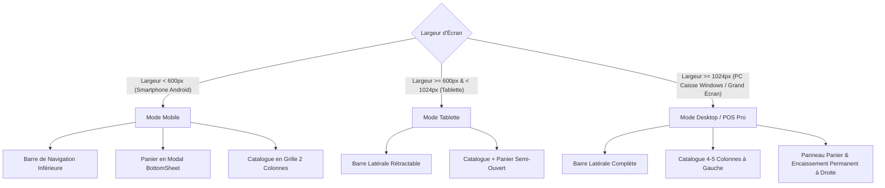

# 06 — Système de Thème & Interface Responsive (Mobile / Desktop)

Ce document décrit le design system visuel de **ARIKE**, sa palette de couleurs inspirée des richesses d'Afrique de l'Ouest, et ses mécanismes d'adaptation responsive aux différents formats d'écran (Smartphones, Tablettes tactiles, Écrans de caisse Windows).

---

## 1. Charte Graphique & Palette de Couleurs

L'identité visuelle d'ARIKE combine la modernité des logiciels fintech contemporains et la noblesse des teintes africaines (Vert forêt profond et Or chaleureux) :

```text
┌────────────────────────────────────────────────────────┐
│ Vert Émeraude Principal : #0B6E4F (Primary)           │
│ Vert Forêt Sombre       : #061B14 (Body Background)   │
│ Vert Conteneur Foncé    : #0A261D (Card & Darkmode)   │
│ Or Béninois Chaleureux  : #E8A317 (Secondary Accent)  │
│ Or Doux Lumineux        : #F5C85A (Gold Soft)         │
│ Vert Céleste Clair      : #9CC3B3 (Light Blue/Mint)   │
│ Texte Lumineux          : #E8F5EF (Light Sky)         │
└────────────────────────────────────────────────────────┘
```

### 1.1 Thème Sombre & Thème Clair
- **Thème Sombre (Dark Mode — Par Défaut)** : Réduit drastiquement la consommation de batterie sur les écrans AMOLED des smartphones et limite la fatigue oculaire lors des longues journées de travail en boutique.
- **Thème Clair (Light Mode)** : Offre une lisibilité maximale en plein soleil sur les étals des marchés extérieurs.

---

## 2. Contrôleur de Mise à l'Échelle d'Interface (`UIScaleController`)

Les commerçants utilisent des appareils très hétérogènes : du smartphone d'entrée de gamme 5 pouces avec une faible densité de pixels jusqu'au PC tout-en-un 21 pouces sous Windows.

ARIKE intègre un contrôleur de zoom dynamique (`lib/core/theme/ui_scale_controller.dart`) :
- **Multiplicateur d'échelle** : Ajustable de `0.85x` (pour afficher plus d'articles par écran) à `1.30x` (pour les utilisateurs souhaitant de grands caractères et des boutons tactiles géants).
- **Dialogue de réglage rapide (`ui_scale_quick_dialog.dart`)** : Accessible en un tap depuis la barre supérieure ou les paramètres.
- **Persistance locale** : La préférence de taille d'affichage est mémorisée localement dans `SharedPreferences`.

---

## 3. Adaptation Ergonomique Responsive

L'application adapte dynamiquement son ergonomie selon la largeur d'écran :



### 3.1 Mode Caisse Desktop Windows (Split-View POS)
Sur écran d'ordinateur Windows :
- Le côté gauche (70% de la largeur) affiche le catalogue d'articles avec filtres rapides, moteur de recherche et indicateurs de stock en temps réel.
- Le côté droit (30% de la largeur) maintient le panier actif toujours visible avec le calcul du total, les modes de règlement et le bouton d'impression directe en un seul clic sans changer d'écran.

