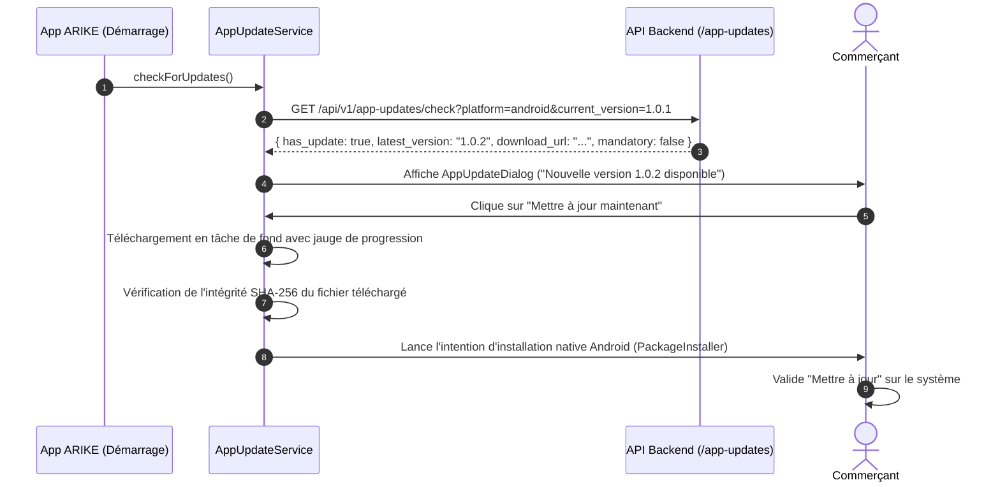

# 07 — Compilation, Déploiement & Système de Mise à Jour Automatique

Ce document décrit les procédures de build de production pour **Android** et **Windows Desktop**, la configuration des signatures et le fonctionnement du mécanisme de mise à jour automatique intégré dans **ARIKE**.

---

## 1. Compilation de Production Android

### 1.1 Configuration des Clés de Signature (`key.properties`)
Créez le fichier `frontend/android/key.properties` :
```properties
storePassword=votre_mot_de_passe_keystore
keyPassword=votre_mot_de_passe_cle
keyAlias=arike-release-key
storeFile=../keystores/arike-release.jks
```

### 1.2 Commandes de Génération du Binaire

#### Option A : APK Universel (Recommandé pour la distribution directe et WhatsApp)
Génère un fichier unique contenant les binaires pour toutes les architectures processeur (ARM64, ARMv7, x86_64) :
```bash
cd frontend
flutter build apk --release
```
Le fichier généré se situe dans :
`frontend/build/app/outputs/flutter-apk/app-release.apk`

#### Option B : Split APKs (Optimisé pour réduire la taille de téléchargement)
Divise l'application par architecture processeur (réduit la taille de l'APK de ~45 Mo à ~18 Mo) :
```bash
flutter build apk --release --split-per-abi
```

#### Option C : Android App Bundle (Pour Google Play Store)
```bash
flutter build appbundle --release
```

---

## 2. Compilation de Production Windows Desktop

### 2.1 Commande de Compilation
```bash
cd frontend
flutter build windows --release
```
Le binaire et les dépendances natives se trouvent dans :
`frontend/build/windows/x64/runner/Release/`

### 2.2 Création de l'Installeur Exécutable (Inno Setup)
Pour fournir aux commerçants un installeur propre en un seul clic (`arike-setup-v1.0.1.exe`) :
1. Télécharger et installer [Inno Setup](https://jrsoftware.org/isdl.php).
2. Compiler le script de configuration Inno Setup situé dans `frontend/windows/packaging/arike_setup.iss`.
3. L'installeur packagera automatiquement :
   - `ARIKE.exe`
   - Les DLLs Flutter (`flutter_windows.dll`)
   - Les bibliothèques SQLite natives (`sqlite3.dll`, extensions de chiffrement)
   - Les raccourcis bureau et menu démarrer.

---

## 3. Système de Mise à Jour Automatique Intégré (`AppUpdateService`)

Puisque de nombreux utilisateurs installent ARIKE via APK direct sans passer par le Google Play Store, l'application intègre son propre gestionnaire de mise à jour sécurisé (`lib/core/updates/`) :



### 3.1 Gestion des Mises à Jour Critiques (`mandatory: true`)
Si une mise à jour est marquée comme obligatoire par l'administrateur (ex : correction d'un bug comptable bloquant ou mise à niveau majeure du protocole de synchronisation) :
- Le bouton *"Plus tard"* est masqué dans le dialogue.
- L'accès aux fonctionnalités de vente est suspendu jusqu'à l'application de la mise à jour pour préserver l'intégrité de la comptabilité.

