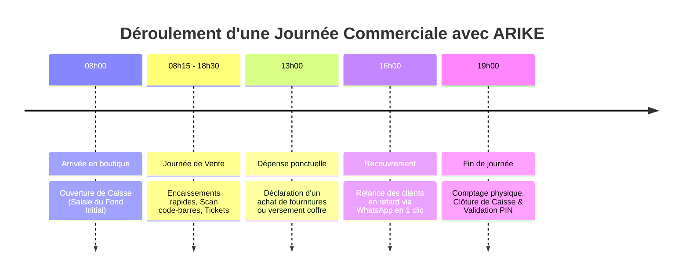

# 09 — Manuel d'Utilisation & Guide Pratique de la Plateforme

Ce guide pratique illustre **l'utilisation quotidienne pas-à-pas** de l'application **ARIKE** par les commerçants, caissiers et gérants de boutique.

---

## 1. Premier Démarrage & Configuration Initiale

### 1.1 Connexion
1. Ouvrir l'application ARIKE sur votre smartphone Android ou votre PC Windows.
2. Saisir votre numéro de téléphone (identifiant principal) et votre mot de passe.
3. Si vous avez activé la biométrie (empreinte digitale), confirmez l'invite pour activer le déverrouillage rapide pour les sessions futures.

### 1.2 Sélection de la Boutique Active
Si votre compte gère plusieurs boutiques (ex : *Boutique Ganhi* et *Dépôt Calavi*) :
- L'application affiche la liste de vos boutiques autorisées.
- Touchez la boutique dans laquelle vous travaillez aujourd'hui. L'application charge immédiatement le stock et les tarifs propres à ce point de vente.

### 1.3 Appairage de l'Imprimante Thermique Bluetooth
1. Mettre sous tension votre imprimante thermique mobile 58mm ou 80mm.
2. Dans ARIKE, aller dans **Paramètres** $\rightarrow$ **Périphériques & Imprimante**.
3. Cliquer sur **Rechercher les imprimantes Bluetooth**.
4. Sélectionner votre imprimante dans la liste (ex : `MTP-II` ou `RPP02N`) et cliquer sur **Imprimer un ticket test**.
5. Dès que le ticket test sort, l'imprimante est mémorisée par défaut pour toutes vos ventes.

---

## 2. La Journée Type d'un Point de Vente

### 2.1 Étape 1 : Ouverture de Caisse (08h00)
1. Au premier écran, cliquer sur le bouton vert **Ouvrir la Caisse**.
2. Saisir le montant du fond de caisse physique présent dans le tiroir (ex : `25 000 FCFA` en monnaie).
3. Cliquer sur **Valider l'ouverture**. Le tableau de bord de caisse s'active.

### 2.2 Étape 2 : Enregistrer une Vente en 3 Secondes
1. **Ajouter les articles au panier** :
   - *Option A* : Scanner le code-barres de l'article avec la caméra ou la douchette.
   - *Option B* : Taper les premières lettres du produit dans la barre de recherche.
   - *Option C* : Utiliser la saisie vocale (Toucher le micro et dire *"Deux sacs de riz 50kg"*).
2. **Ajuster les quantités** en touchant `+` ou `-`.
3. **Choisir le mode de paiement** :
   - Toucher **Espèces** si le client paie en billets (le calculateur de monnaie à rendre s'affiche automatiquement).
   - Toucher **MoMo / Moov** si le client paie par Mobile Money.
   - Toucher **Crédit** si le client prend à crédit (l'application demande de sélectionner la fiche du client).
4. Cliquer sur **Valider la Vente** :
   - Le stock est immédiatement décrémenté.
   - L'imprimante thermique édite instantanément le ticket de caisse.

### 2.3 Étape 3 : Mouvements Ponctuels d'Espèces en Cours de Journée
- **Dépôt au coffre (DROP)** : En fin d'après-midi, si la caisse contient trop de liquide, cliquer sur **Mouvement** $\rightarrow$ **Versement Coffre**, saisir le montant (ex : `100 000 FCFA`). Cela sécurise la caisse sans fausser la comptabilité.
- **Dépense en caisse (EXPENSE)** : Pour payer une course ou une facture avec l'argent du tiroir, cliquer sur **Dépense en caisse**, indiquer le montant et le motif (ex : `3 000 F - Achat ampoule boutique`).

### 2.4 Étape 4 : Clôture de Caisse & Traitement des Écarts (19h00)
1. Cliquer sur **Clôturer la Caisse**.
2. La boîte de dialogue présente les champs de comptage physique.
3. Pour gagner du temps, le commerçant peut cliquer sur le bouton :
   👉 **"Remplir avec les soldes théoriques attendus"**.
4. Ajuster le montant physique réel compté billet par billet.
5. **Résultats possibles** :
   - **Écart = 0 F** : Tout est parfait. Cliquer sur **Confirmer la clôture**.
   - **Écart constaté** (ex : `-2 000 F`) : L'application exige un motif textuel (ex : *"Erreur de monnaie billet abîmé"*).
   - Le gérant présent tape son **code PIN à 4 chiffres** pour valider immédiatement la clôture.
   - Si le gérant est absent, le caissier clique sur **Soumettre pour approbation** (`PENDING_APPROVAL`). La caisse est verrouillée et attend la validation du gérant le lendemain matin.

---

## 3. Gestion des Dettes & Relance WhatsApp

### 3.1 Vendre à Crédit
Lors d'une vente, sélectionner le mode de paiement **Crédit**. L'application propose la liste de vos clients enregistrés avec leur solde actuel et leur date limite de crédit.

### 3.2 Relancer un Client Débiteur
1. Aller dans l'onglet **Dettes & Crédits**.
2. Les clients en retard apparaissent dans la section **Créances en Retard** sur fond rouge.
3. Toucher le bouton vert **Relance WhatsApp** en face du nom du client.
4. L'application bascule automatiquement sur WhatsApp avec un message professionnel pré-rédigé contenant le nom de la boutique, le montant exact dû et votre numéro MoMo de règlement. Il ne reste qu'à appuyer sur **Envoyer**.

---

## 4. Sauvegarde Sécurisée sur Google Drive

1. Aller dans **Paramètres** $\rightarrow$ **Sauvegarde Cloud Google Drive**.
2. Cliquer sur **Se connecter avec Google** et autoriser l'accès à votre Drive.
3. Définir un mot de passe de chiffrement personnel.
4. Cliquer sur **Créer une sauvegarde maintenant**.
5. L'application chiffre l'intégralité de votre base de données locale (AES-256) et l'envoie sur votre Google Drive privé. Vos données sont à l'abri même si votre téléphone est volé ou détruit.

---

## 5. Raccourcis Clavier pour la Caisse Windows Desktop

Sur ordinateur de caisse avec clavier physique :
- `F1` : Ouvrir la recherche rapide d'articles.
- `F2` : Sélectionner le paiement en Espèces.
- `F3` : Sélectionner le paiement par Mobile Money.
- `F4` : Valider et imprimer le ticket immédiatement.
- `Échap` : Annuler ou vider le panier en cours.
- `Alt + C` : Ouvrir le tiroir-caisse connecté.
