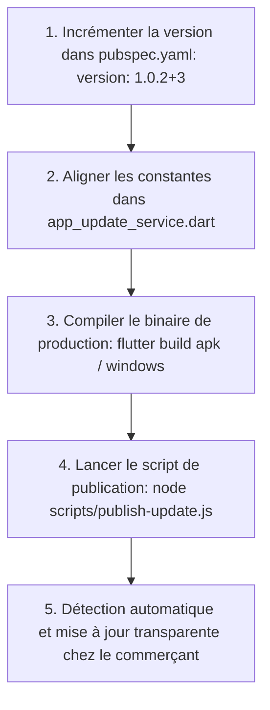
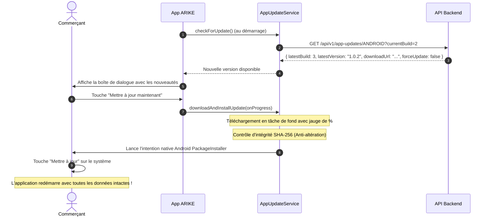

# 10 — Guide des Mises à Jour Clients & Système d'Auto-Update

Ce document explique le cycle complet de création, de livraison et d'installation des **mises à jour de l'application cliente ARIKE** (Android APK et Windows Desktop).

---

## 1. Cycle de Publication d'une Nouvelle Version (Côté Développeur)

Lorsqu'une nouvelle fonctionnalité ou un correctif est prêt à être livré aux commerçants, suivez scrupuleusement ces 5 étapes :



### Étape 1 : Incrémenter la Version dans `pubspec.yaml`
Ouvrir `frontend/pubspec.yaml` et modifier la directive `version` :
```yaml
# Format : <version_name>+<build_number>
# Le build_number DOIT toujours être strictement supérieur au précédent (+1)
version: 1.0.2+3
```

### Étape 2 : Aligner les Constantes dans `app_update_service.dart`
Ouvrir `frontend/lib/core/updates/app_update_service.dart` et mettre à jour les constantes locales :
```dart
static const currentVersion = '1.0.2';
static const currentBuild = 3;
```

### Étape 3 : Compiler les Binaires de Production

#### Pour Android :
```bash
cd frontend

# Option recommandée (légère < 35 Mo, idéale pour les forfaits mobiles en Afrique) :
flutter build apk --release --split-per-abi

# Ou option universelle (fonctionne sur 100% des téléphones) :
flutter build apk --release
```

#### Pour Windows Desktop :
```powershell
cd frontend
flutter build windows --release

# Générer l'installeur propre en un seul clic (.exe) avec Inno Setup
iscc windows/packaging/arike_setup.iss
```

### Étape 4 : Publier la Mise à Jour sur Supabase
Depuis le dossier `backend/` :
```bash
cd ../backend

# Publication Android
node scripts/publish-update.js \
  --platform=ANDROID \
  --version=1.0.2 \
  --build=3 \
  --file="../frontend/build/app/outputs/flutter-apk/app-arm64-v8a-release.apk" \
  --notes="• Clôture de caisse simplifiée avec bouton des soldes théoriques\n• Impression thermique optimisée"

# Publication Windows
node scripts/publish-update.js \
  --platform=WINDOWS \
  --version=1.0.2 \
  --build=3 \
  --file="../frontend/build/windows/installer/arike-setup-v1.0.2.exe" \
  --notes="• Raccourcis clavier améliorés en caisse"
```

---

## 2. Déroulement Côté Client (Expérience Commerçant)

L'expérience de mise à jour a été spécialement conçue pour être fluide, rassurante et sans perte de données :



### 2.1 Présentation du Dialogue (`AppUpdateDialog`)
Le dialogue informe clairement le commerçant :
- **Badge de version** : *"Version 1.0.2 disponible (votre version : 1.0.1)"*.
- **Notes de version** : Explication claire en français des améliorations.
- **Bouton d'action** : *"Mettre à jour maintenant"* ou *"Plus tard"* (si optionnelle).

### 2.2 Contrôle Cryptographique d'Intégrité (SHA-256)
Avant de lancer l'installation, `AppUpdateService` calcule le hash SHA-256 du fichier téléchargé :
- Si le hash correspond à l'empreinte signée du serveur $\rightarrow$ Installation autorisée.
- Si le fichier a été tronqué (mauvaise connexion) ou altéré $\rightarrow$ Le fichier temporaire est détruit et une notification d'erreur s'affiche sans endommager l'application existante.

### 2.3 Autorisation Android "Sources Inconnues" (`REQUEST_INSTALL_PACKAGES`)
Pour les téléphones installant ARIKE hors du Play Store :
1. Android demande une seule fois : *"Autoriser ARIKE à installer des applications inconnues"*.
2. L'application guide le commerçant pour cocher l'interrupteur dans les paramètres du téléphone.
3. L'installation se finalise ensuite automatiquement.

### 2.4 Mode "Mise à Jour Obligatoire" (`forceUpdate = true`)
Si une mise à jour apporte une modification critique au protocole comptable ou de synchronisation :
- Le paramètre `--force` est activé lors de la publication.
- Le bouton *"Plus tard"* disparaît de l'écran.
- L'utilisateur est invité à installer la mise à jour pour garantir l'intégrité de ses comptes.
- **Toutes les données locales (ventes, stocks, caisses) sont scrupuleusement préservées** lors de la mise à jour.

### 2.5 Résilience Hors-Ligne
Si le commerçant démarre l'application sans connexion Internet, la vérification de mise à jour échoue silencieusement en arrière-plan sans afficher de message d'erreur et sans ralentir le démarrage de la caisse.

