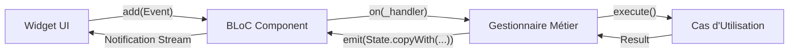

# Gestion d'État avec Flutter BLoC

Ce document documente les conventions de gestion d'état et le cycle de vie des BLoCs dans ARIKE.

---

## 1. Cycle de Vie d'un BLoC



---

## 2. Décomposition des États (`State Pattern`)

Chaque état de BLoC hérite de `Equatable` et gère explicitement les phases de chargement, de succès et d'échec :

```dart
class CashSessionsState extends Equatable {
  final bool isLoading;
  final CashSessionEntity? currentSession;
  final String? errorMessage;
  final String? successMessage;
  final double? liveExpectedCash;

  const CashSessionsState({
    this.isLoading = false,
    this.currentSession,
    this.errorMessage,
    this.successMessage,
    this.liveExpectedCash,
  });

  CashSessionsState copyWith({
    bool? isLoading,
    CashSessionEntity? currentSession,
    String? errorMessage,
    String? successMessage,
    double? liveExpectedCash,
  }) {
    return CashSessionsState(
      isLoading: isLoading ?? this.isLoading,
      currentSession: currentSession ?? this.currentSession,
      errorMessage: errorMessage,
      successMessage: successMessage,
      liveExpectedCash: liveExpectedCash ?? this.liveExpectedCash,
    );
  }

  @override
  List<Object?> get props => [isLoading, currentSession, errorMessage, successMessage, liveExpectedCash];
}
```

